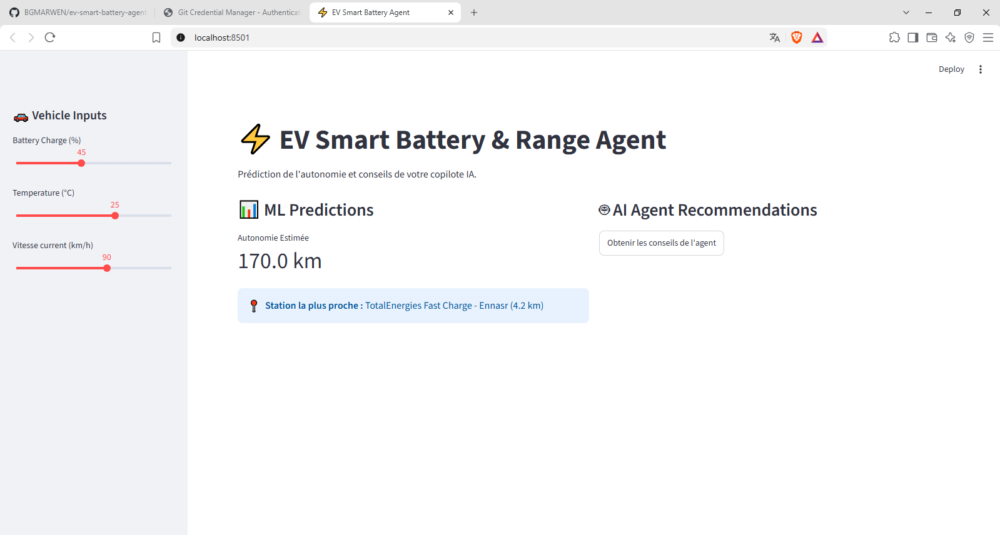
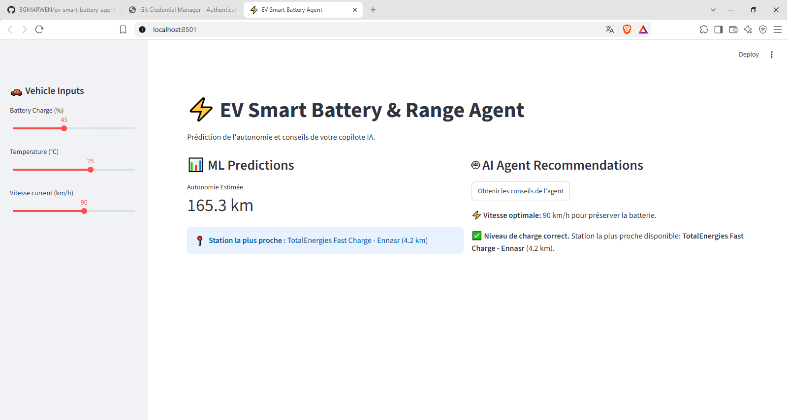
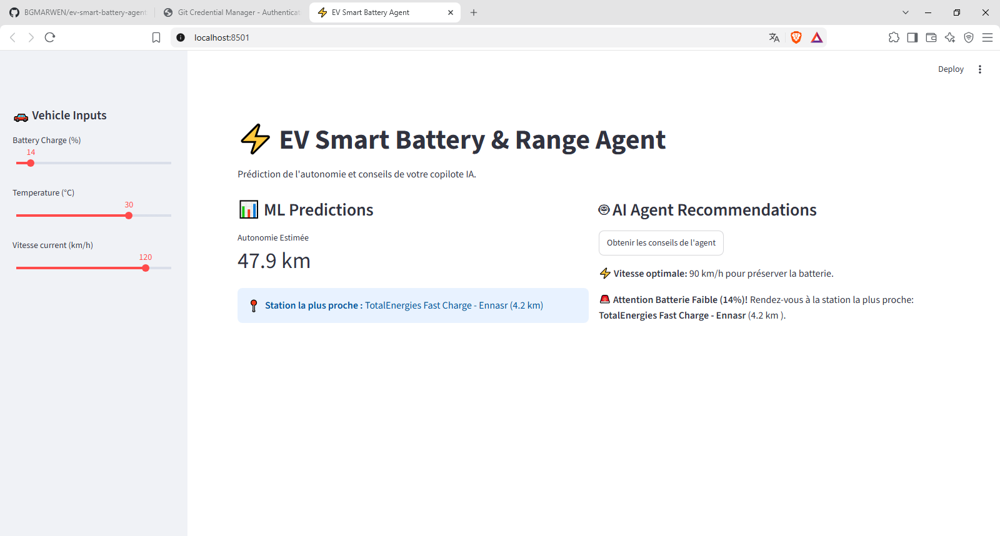

# ⚡ EV Smart Battery Agent

An electric vehicle (EV) assistant that combines machine learning, charging station discovery, and an AI-based recommendation agent to support smarter driving and charging decisions.

## 🚀 Project Overview

EV Smart Battery Agent estimates vehicle performance under different battery and driving conditions, identifies a nearby charging station using the available station data, and provides recommendations through an interactive Streamlit dashboard.

## ✨ Features

- **Machine Learning Prediction:** Estimates optimal driving speed based on battery and driving conditions.
- **Charging Station Finder:** Helps identify a nearby charging station.
- **AI Recommendation Agent:** Provides battery-related guidance and charging recommendations.
- **Battery Automation:** Integrates battery-related automation logic where implemented in the application.
- **Interactive Dashboard:** Presents inputs, predictions, and recommendations through a Streamlit interface.

## 🛠️ Technologies

- Python
- Streamlit
- Pandas
- NumPy
- Scikit-learn
- Python-dotenv

## 📁 Project Structure

```text
ev-smart-battery-agent/
├── src/
│   ├── ml_model.py
│   ├── station_finder.py
│   └── battery_agent.py
├── app.py
├── requirements.txt
├── .gitignore
└── README.md
```

## ⚙️ Installation

### 1. Clone the repository

```bash
git clone https://github.com/BGMARWEN/ev-smart-battery-agent.git
cd ev-smart-battery-agent
```

### 2. Create a virtual environment

```bash
python -m venv venv
```

Activate it on Windows:

```powershell
.\venv\Scripts\Activate.ps1
```

### 3. Install dependencies

```bash
pip install -r requirements.txt
```

### 4. Run the application

```bash
streamlit run app.py
```

## 💡 How to Use

1. Launch the Streamlit application.
2. Enter the available battery and driving parameters.
3. Review the model's prediction.
4. Check the charging station information.
5. Read the recommendations generated by the agent.

## 🔬 Model and Limitations

Prediction quality depends on the model, its training data, and the assumptions used. Results should not be treated as guaranteed real-world vehicle performance or safety advice.

Charging station accuracy depends on the station dataset and the method used to calculate distance. Live station availability and GPS integration should only be claimed if implemented.

## 🔮 Future Improvements

- Validate the model with real-world electric vehicle data.
- Add model evaluation metrics and automated tests.
- Integrate live charging station data and GPS-based location.
- Improve battery monitoring and deployment.

## 👨‍💻 Author

**BOUGHDIRI MARWEN**

## 📄 License

No license has been added yet.

## 📸 Application Screenshots

### 1. Main Dashboard

The main interface displays the battery charge, temperature, current speed, estimated driving range, and nearest charging station.



### 2. AI Agent Recommendations

The AI agent analyzes the initial vehicle inputs and provides battery-related recommendations, including an optimal speed suggestion.



### 3. Updated Inputs and Recommendations

The dashboard demonstrates how the AI agent's recommendations change when the vehicle input values are updated.



